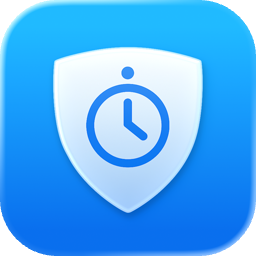
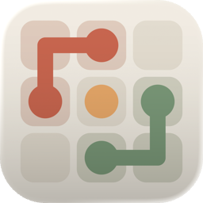
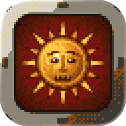
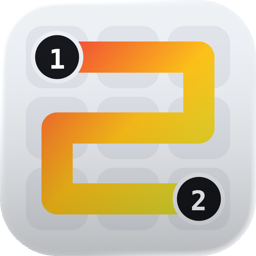
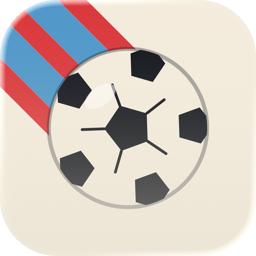
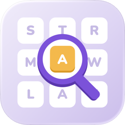
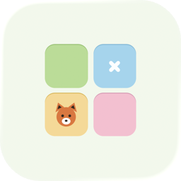
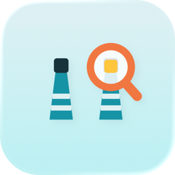
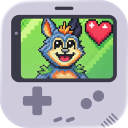

# Hi, I'm Bruno 👋

**Principal Software Engineer · iOS** — Lisbon, Portugal

I build iOS products that make identity and authentication feel simple. 12+ years on Apple platforms, 20+ apps shipped. I lead a mobile team of 6 (iOS and Android) at SecureAuth and still write code every day.

---

### What I work on

- 🔐 **Passkeys and passwordless sign-in.** FIDO-certified apps on iPhone and iPad
- 🏢 **Enterprise mobile auth.** One-time codes, push approvals, adaptive sign-in, trusted devices
- 🛡️ **Privacy-first design.** Credentials stay on the device, no tracking
- 🚀 **Shipping at scale.** Global releases every month, 99.99% crash-free

### Tech stack

| | |
|---|---|
| **Apple** | Swift · SwiftUI · UIKit · Objective-C · SwiftData · Combine · StoreKit · WidgetKit · GameKit · AuthenticationServices (passkeys) · CryptoKit · iOS · iPadOS · macOS · watchOS |
| **Android** | Kotlin · Jetpack Compose · Java |
| **Games** | Godot (GDScript, shaders) · SpriteKit |
| **Windows** | C# · .NET · WinUI |
| **Web and backend** | TypeScript · React · Next.js · Astro · Tailwind · Vite · Vitest · PHP · MySQL · Python · Firebase · Docker |

---

### Side projects

**[QuickOTP](https://quickotp.app)**: a privacy-first authenticator for iPhone, iPad and Mac. TOTP codes and passkeys with no network calls and no tracking. 
  

 

**[FYR Games](https://fyrgames.com/quick/)**: my indie studio of puzzle and casual games for iPhone and Android, in 10 languages.

<table>
<tr><td align="center" width="25%"> <a href="https://fyrgames.com/colorcurious/"> <b>Color Curious</b></a> Flow puzzle</td><td align="center" width="25%"> <a href="https://fyrgames.com/sunkeepers/"> <b>Sun Keepers</b></a> Minesweeper adventure</td><td align="center" width="25%"> <a href="https://fyrgames.com/numberline/"> <b>Number Line</b></a> Path puzzle</td><td align="center" width="25%"> <a href="https://fyrgames.com/goalline/"> <b>Goal Line</b></a> Football puzzle</td></tr>
<tr><td align="center" width="25%"> <a href="https://fyrgames.com/wordatlas/"> <b>Word Atlas</b></a> Word search</td><td align="center" width="25%"> <a href="https://fyrgames.com/wildsudoku/"> <b>Wild Sudoku</b></a> Queens-style logic</td><td align="center" width="25%"> <a href="https://fyrgames.com/worldhunt/"> <b>World Hunt</b></a> Spot the differences</td><td align="center" width="25%"> <a href="https://fyrgames.com/tamii/"> <b>Tamii</b></a> Virtual pet</td></tr>
</table>

Coming soon: <b>Pitch Boss</b> (football manager) · <b>Bubble Bop</b> (roguelike rescue) · <b>Tombfall</b> (dungeon crawler RPG)

---

### Experience

**Principal Software Engineer · SecureAuth** (remote, USA) · *2016 – present* 
I lead mobile engineering for identity and authentication, from Acceptto through the SecureAuth acquisition.

**Mobile Developer · BOLD International (Carbon)** · *2014 – 2017* 
iOS for clients worldwide, including Vivo, BNP Paribas, Veja and Ipiranga.

---

More on [brunotereso.net](https://www.brunotereso.net)
